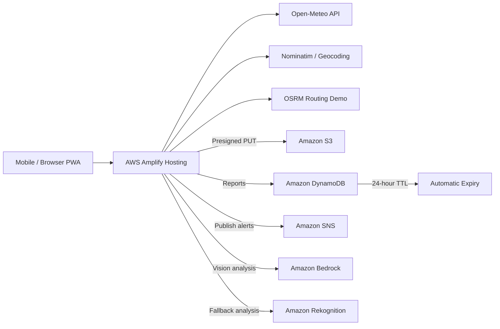

# FloodLoop AI

**Maharashtra Flood Watch — awareness, crowd-sourced flood reporting, and safer route guidance.**

[](https://aws-six-zeta.vercel.app)
[](https://nextjs.org)
[](https://www.typescriptlang.org)
[](https://aws.amazon.com)

A mobile-first, installable web application for flood awareness across Maharashtra. FloodLoop AI combines an interactive risk map, community reports, weather context, image analysis, and flood-safe route suggestions in one accessible experience.

> **Public demo:** [aws-six-zeta.vercel.app](https://aws-six-zeta.vercel.app)

## Key Features

- **Interactive flood-risk map** — Explore hotspots across Maharashtra with Leaflet and OpenStreetMap.
- **Community reporting** — Submit flood observations with location, severity, optional photos, and 24-hour report retention.
- **AI-assisted image analysis** — Use Amazon Bedrock or Amazon Rekognition to assess uploaded flood scenes.
- **Safer route planning** — Sample alternate routes and identify flood-risk exposure before travel.
- **Weather integration** — Display rainfall and weather context for selected locations.
- **Email alerts** — Subscribe to local notifications through Amazon SNS.
- **Bilingual interface** — Switch between English and Marathi.
- **Progressive Web App** — Install on mobile or desktop and use the app outside a traditional browser window.
- **Resilient demo mode** — Continue operating with local or mock data when AWS services are unavailable.

## Technology Stack

| Layer | Technology |
|---|---|
| Framework | Next.js 16 App Router |
| Language | TypeScript |
| UI | React 19, Tailwind CSS 4 |
| Maps | Leaflet, React Leaflet, OpenStreetMap |
| Charts | Recharts |
| Cloud hosting | AWS Amplify Hosting |
| Storage | Amazon DynamoDB, Amazon S3 |
| AI / vision | Amazon Bedrock, Amazon Rekognition |
| Notifications | Amazon SNS |
| Geocoding / routing | Nominatim and public OSRM demo services |

## AWS Architecture



### AWS Services

- **AWS Amplify Hosting** — Builds and hosts the Next.js server-rendered application.
- **Amazon DynamoDB** — Stores community reports with automatic 24-hour TTL expiry.
- **Amazon S3** — Stores private report photos using short-lived presigned upload and download URLs.
- **Amazon Bedrock** — Provides vision analysis with a configurable foundation model.
- **Amazon Rekognition** — Offers label detection as an alternative analysis provider.
- **Amazon SNS** — Supports alert subscriptions and notifications.

## API Routes

| Route | Purpose |
|---|---|
| `/api/weather` | Fetches weather context and rainfall data. |
| `/api/geocode` | Resolves places and coordinates. |
| `/api/upload-url` | Generates private S3 presigned upload URLs. |
| `/api/analyze` | Runs Bedrock or Rekognition image analysis. |
| `/api/reports` | Creates (`201`) and retrieves paginated, filtered public flood reports (Prisma + SQLite/PostgreSQL). |
| `/api/reports/[id]` | Fetches a single public report (`404` if missing). |
| `/api/alerts/subscribe` | Registers an email + optional district/area and sends a confirmation link. |
| `/api/alerts/confirm` | Confirms a subscription via token. |
| `/api/alerts/unsubscribe` | Unsubscribes via token. |
| `/api/routes` | Computes 2-3 de-duplicated vehicle-aware routes (`bike`, `car`, `bus`, `walk`) with 0-100 safety scores. |
| `/api/chat` | Gemini-powered Safety Assistant grounded in FloodLoop precaution guidance. |

## Database Setup (Prisma)

Locally, FloodLoop uses SQLite (`DATABASE_URL="file:./dev.db"`). Because AWS Amplify Hosting has no persistent local disk, **production deployments must use a hosted PostgreSQL database** (Amazon RDS, Neon, or Supabase) by updating `provider = "postgresql"` in `prisma/schema.prisma` and setting `DATABASE_URL` in Amplify environment variables.

```bash
# Run migrations and generate Prisma Client
npx prisma migrate dev
npx prisma generate

# Seed initial Maharashtra flood reports
npx prisma db seed
```

## Email Alerts (SES / SMTP / Console)

- Set `EMAIL_PROVIDER` to `ses`, `smtp`, or `console` (default for local dev).
- In **AWS SES sandbox mode**, SES only sends emails to verified recipient addresses until you request production access.
- When credentials are missing, emails (including confirmation and unsubscribe links) are logged to the server console.

## AI Safety Chatbot Grounding & Customization

- **Server-side only**: `LLM_PROVIDER=gemini`, `LLM_API_KEY` (Google AI Studio key starting with `AIza...`), and `LLM_MODEL` (e.g. `gemini-2.5-flash`).
- **Grounding**: `lib/llm.ts` injects the Do's & Don'ts, river flood safety, ghat landslide safety, and emergency helplines from `lib/i18n.ts` into the Gemini `systemInstruction`, plus the user's current `riskLevel`.
- **Editing the prompt & chips**: Edit `SAFETY_ASSISTANT_SYSTEM_PROMPT` in `lib/llm.ts` and `chatChips` in `lib/i18n.ts`.

## Curl Examples

```bash
# Create a public report
curl -X POST http://localhost:3000/api/reports \
  -H "Content-Type: application/json" \
  -d '{"type":"waterlogging","description":"Knee-deep water near Dadar TT","latitude":19.0178,"longitude":72.8478,"severity":"high"}'

# List active reports
curl "http://localhost:3000/api/reports?status=active&limit=10"

# Subscribe to email alerts
curl -X POST http://localhost:3000/api/alerts/subscribe \
  -H "Content-Type: application/json" \
  -d '{"email":"commuter@example.com","district":"Mumbai"}'

# Get vehicle-aware safe routes
curl "http://localhost:3000/api/routes?from=19.0178,72.8478&to=19.1197,72.8464&vehicle=bike"

# Ask the Safety Assistant
curl -X POST http://localhost:3000/api/chat \
  -H "Content-Type: application/json" \
  -d '{"message":"Is it safe to drive through water?","history":[],"riskLevel":"high","language":"en"}'
```

## Project Structure

```text
app/          Next.js pages, layouts, styles, and API routes
components/   Map, reporting, risk, route, alert, and language UI
lib/          Geospatial, risk, storage, and localization utilities
data/         Demonstration hotspot data
public/       PWA manifest and application icons
```

## Local Development

### Prerequisites

- Node.js 20 or later
- npm
- AWS credentials or demo mode for cloud-independent development

### Start the app

```bash
npm install
cp .env.example .env.local
npm run dev
```

Open [http://localhost:3000](http://localhost:3000).

## Environment Variables

Create `.env.local` for local development, or configure these values in AWS Amplify.

| Variable | Required | Description |
|---|---|---|
| `ANALYZE_PROVIDER` | No | `bedrock`, `rekognition`, or `mock`. Defaults to `mock`. |
| `BEDROCK_MODEL_ID` | With Bedrock | Vision-capable Bedrock model ID. |
| `AWS_REGION` | With AWS services | AWS region, such as `ap-south-1`. |
| `DDB_TABLE` | No | DynamoDB report table name. |
| `S3_BUCKET` | No | Private S3 bucket for uploaded photos. |
| `SNS_TOPIC_ARN` | No | SNS topic ARN for email alerts. |

> Never commit AWS credentials or secrets. The application is designed to use an IAM role, service role, or standard AWS credential chain.

## Deployment

For AWS resources, IAM permissions, and Amplify configuration, follow the complete [deployment guide](DEPLOY.md).

## Data and Safety Notice

The 18 demonstration hotspots included in `data/hotspots.json` use estimated coordinates, elevations, and vulnerability scores. They are intended for prototype and hackathon use, not emergency decision-making.

Before any production deployment:

- Replace demonstration coordinates with verified MCGM/BMC, IMD, irrigation department, and state disaster-management data.
- Configure authoritative, real-time weather and road-closure feeds.
- Validate all routing and hazard recommendations.
- Establish moderation and abuse-prevention processes for community reports.

Public Nominatim and OSRM demo services are rate-limited and may not provide production-grade traffic or closure information.

## Available Scripts

```bash
npm run dev     # Start the development server
npm run build   # Create an optimized production build
npm run start   # Start the production server
npm run lint    # Run ESLint
npm test        # Run Vitest unit and API tests
```

## Contributing

1. Fork the repository.
2. Create a feature branch.
3. Make your changes with clear commit messages.
4. Run `npm run lint` and `npm run build`.
5. Open a pull request describing the change and its testing.

## License

No license has been specified for this repository. Add a license before reusing or distributing the project beyond the original contributor workflow.
