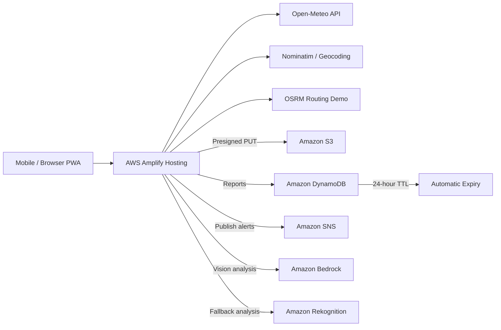

# FloodLoop AI

**Maharashtra Flood Watch — awareness, crowd-sourced flood reporting, and safer route guidance.**

[](https://aws-six-zeta.vercel.app)
[](https://nextjs.org)
[](https://www.typescriptlang.org)
[](https://aws.amazon.com)

A mobile-first, installable web application for flood awareness across Maharashtra. FloodLoop AI combines an interactive risk map, community reports, weather context, image analysis, and flood-safe route suggestions in one accessible experience.

> **Public demo:** [aws-six-zeta.vercel.app](https://aws-six-zeta.vercel.app)

## Key Features

- **Interactive flood-risk map** — Explore hotspots across Maharashtra with Leaflet and OpenStreetMap.
- **Community reporting** — Submit flood observations with location, severity, optional photos, and 24-hour report retention.
- **AI-assisted image analysis** — Use Amazon Bedrock or Amazon Rekognition to assess uploaded flood scenes.
- **Safer route planning** — Sample alternate routes and identify flood-risk exposure before travel.
- **Weather integration** — Display rainfall and weather context for selected locations.
- **Email alerts** — Subscribe to local notifications through Amazon SNS.
- **Bilingual interface** — Switch between English and Marathi.
- **Progressive Web App** — Install on mobile or desktop and use the app outside a traditional browser window.
- **Resilient demo mode** — Continue operating with local or mock data when AWS services are unavailable.

## Technology Stack

| Layer | Technology |
|---|---|
| Framework | Next.js 16 App Router |
| Language | TypeScript |
| UI | React 19, Tailwind CSS 4 |
| Maps | Leaflet, React Leaflet, OpenStreetMap |
| Charts | Recharts |
| Cloud hosting | AWS Amplify Hosting |
| Storage | Amazon DynamoDB, Amazon S3 |
| AI / vision | Amazon Bedrock, Amazon Rekognition |
| Notifications | Amazon SNS |
| Geocoding / routing | Nominatim and public OSRM demo services |

## AWS Architecture



### AWS Services

- **AWS Amplify Hosting** — Builds and hosts the Next.js server-rendered application.
- **Amazon DynamoDB** — Stores community reports with automatic 24-hour TTL expiry.
- **Amazon S3** — Stores private report photos using short-lived presigned upload and download URLs.
- **Amazon Bedrock** — Provides vision analysis with a configurable foundation model.
- **Amazon Rekognition** — Offers label detection as an alternative analysis provider.
- **Amazon SNS** — Supports alert subscriptions and notifications.

## API Routes

| Route | Purpose |
|---|---|
| `/api/weather` | Fetches weather context and rainfall data. |
| `/api/geocode` | Resolves places and coordinates. |
| `/api/upload-url` | Generates private S3 presigned upload URLs. |
| `/api/analyze` | Runs Bedrock or Rekognition image analysis. |
| `/api/reports` | Creates (`POST`) and lists (`GET`) public community flood reports in SQLite/PostgreSQL via Prisma. |
| `/api/reports/[id]` | Fetches a single public report by ID (`404` if not found). |
| `/api/routes` | Computes 2–3 alternative routes ranked by vehicle-specific safety score (`0–100`). |
| `/api/subscribe` | Registers an email for flood alerts. |
| `/api/alert` | Publishes a high-severity notification. |
| `/api/chat` | Answers safety questions grounded in the precaution guidance (`POST`). |

## Project Structure

```text
app/          Next.js pages, layouts, styles, and API routes
components/   Map, reporting, risk, route, alert, and language UI
lib/          Geospatial, risk, storage, and localization utilities
data/         Demonstration hotspot data
public/       PWA manifest and application icons
```

## Local Development

### Prerequisites

- Node.js 20 or later
- npm
- AWS credentials or demo mode for cloud-independent development

### Start the app

```bash
npm install
cp .env.example .env
npx prisma migrate deploy
npx prisma db seed
npm run dev
```

Open [http://localhost:3000](http://localhost:3000).

### Database Migrations & Seeding

The app uses **Prisma** with SQLite by default (`DATABASE_URL="file:./dev.db"`).

- **Apply migrations (creates/updates the database schema):**
  ```bash
  npx prisma migrate deploy
  ```
- **Seed sample public reports (or import from `data/reports.seed.json` / `SEED_REPORTS_FILE`):**
  ```bash
  npx prisma db seed
  ```
- **Switch to PostgreSQL / MySQL (e.g., AWS RDS):** Update `DATABASE_URL` in `.env`, set `provider = "postgresql"` (or `"mysql"`) in `prisma/schema.prisma`, and run `npx prisma migrate deploy`.

## Environment Variables

Create `.env` (or `.env.local`) for local development, or configure these values in AWS Amplify.

| Variable | Required | Description |
|---|---|---|
| `DATABASE_URL` | Yes | Database connection string (defaults to `file:./dev.db` for local SQLite). |
| `ALLOWED_ORIGINS` | No | Comma-separated list of allowed CORS frontend origins (defaults to `http://localhost:3000`). |
| `ANALYZE_PROVIDER` | No | `bedrock`, `rekognition`, or `mock`. Defaults to `mock`. |
| `BEDROCK_MODEL_ID` | With Bedrock | Vision-capable Bedrock model ID. |
| `AWS_REGION` | With AWS services | AWS region, such as `ap-south-1`. |
| `DDB_TABLE` | No | Legacy DynamoDB report table name (optional). |
| `S3_BUCKET` | No | Private S3 bucket for uploaded photos. |
| `SNS_TOPIC_ARN` | No | SNS topic ARN for email alerts. |
| `OSRM_BASE_URL` | No | OSRM routing server base URL (defaults to `https://router.project-osrm.org`). |
| `ROUTES_CACHE_TTL_MS` | No | In-memory route cache TTL in ms (defaults to `180000`, i.e., 3 minutes). |
| `LLM_PROVIDER` | No | Precaution chatbot provider: `gemini` (default), `openai`, or `bedrock`. |
| `LLM_API_KEY` | With Gemini/OpenAI | Server-only API key for the precaution chatbot (`gemini` or `openai`). Never expose to the browser. |
| `LLM_MODEL` | No | Model ID (defaults to `gemini-2.5-flash` for Gemini, `gpt-4o-mini` for OpenAI, `amazon.nova-lite-v1:0` for Bedrock). |
| `LLM_BASE_URL` | No | Optional custom base URL for OpenAI-compatible providers. |
| `CHAT_RATE_LIMIT_MAX` | No | Max chat requests per IP per window (defaults to `15`). |
| `CHAT_RATE_LIMIT_WINDOW_MS` | No | Chat rate-limit window in ms (defaults to `60000`). |

### Precaution Safety Chatbot (`POST /api/chat`)

The **Precautions** tab includes an AI safety assistant (`components/PrecautionChat.tsx`) backed by `POST /api/chat` (`app/api/chat/route.ts` and `lib/chatHandler.ts`).

- **Setup:** Set `LLM_PROVIDER=gemini` (default) and `LLM_API_KEY` in `.env` (or `.env.local`), or set `LLM_PROVIDER=bedrock` to use AWS credentials.
- **Content grounding:** `buildPrecautionKnowledge()` in `lib/precautionPrompt.ts` dynamically extracts all risk-level Do's/Don'ts, river flood advice, ghat landslide advice, and Maharashtra emergency contacts from `lib/i18n.ts` and injects them into the system prompt along with the currently selected city, risk level, and language.
- **Editing the system prompt:** Update `PRECAUTION_SYSTEM_RULES` in `lib/precautionPrompt.ts`.
- **Editing suggested questions:** Update `CHAT_COPY[lang].suggestions` in `components/PrecautionChat.tsx`.

### Public Reports API (`POST /api/reports`, `GET /api/reports`, `GET /api/reports/{id}`)

- **Create a report (`POST /api/reports`):**
  ```bash
  curl -X POST http://localhost:3000/api/reports \
    -H "Content-Type: application/json" \
    -d '{"title":"Sion Underpass","type":"waterlogging","description":"Knee-deep water near Sion Circle","latitude":19.0434,"longitude":72.8634,"severity":"high","waterPresent":true}'
  ```
- **List reports (`GET /api/reports`) with pagination & filters:**
  ```bash
  curl "http://localhost:3000/api/reports?limit=20&offset=0&status=active&type=waterlogging"
  curl "http://localhost:3000/api/reports?min_lat=18.9&max_lat=19.2&min_lng=72.7&max_lng=73.0"
  curl "http://localhost:3000/api/reports?lat=19.04&lng=72.86&radius_km=10"
  ```
- **Get a report by ID (`GET /api/reports/{id}`):**
  ```bash
  curl http://localhost:3000/api/reports/seed-rep-mumbai-sion
  ```

### Safe Route Suggestions API (`GET /api/routes`)

Query 2–3 alternative routes ranked by safety for a specific vehicle (`bike`, `car`, `bus`, or `walk`):

```bash
curl "http://localhost:3000/api/routes?from=19.0178,72.8478&to=19.0728,72.8826&vehicle=bike"
```

- **Vehicle profiles:** `bike` → `cycling`, `car` → `driving`, `walk` → `foot`, `bus` → `driving` (public OSRM has no dedicated bus/transit profile; a disclaimer is returned in the response and UI).
- **Safety Score (`0–100`, higher is safer):** Computed in `computeSafetyScore()` (`lib/safeRoutes.ts`):
  1. **Hazard Proximity (60% weight):** Samples route geometry every ~75 m and counts active flood hotspots and verified community reports within 200 m, weighted by severity (`low: 0.25`, `medium: 0.50`, `high: 0.80`, `severe: 1.0`).
  2. **Vehicle Road-Type Suitability (25% weight):** Uses OSRM step road names/refs and geometry (e.g., penalizes highways for `bike` and `walk`, penalizes narrow shortcuts and sharp turns for `bus`, prefers main roads for `car`).
  3. **Route Complexity (15% weight):** Normalizes sharp turns (>45°) and road-name transitions per km.

> Never commit AWS credentials or secrets. The application is designed to use an IAM role, service role, or standard AWS credential chain.

## Deployment

For AWS resources, IAM permissions, and Amplify configuration, follow the complete [deployment guide](DEPLOY.md).

## Data and Safety Notice

The 18 demonstration hotspots included in `data/hotspots.json` use estimated coordinates, elevations, and vulnerability scores. They are intended for prototype and hackathon use, not emergency decision-making.

Before any production deployment:

- Replace demonstration coordinates with verified MCGM/BMC, IMD, irrigation department, and state disaster-management data.
- Configure authoritative, real-time weather and road-closure feeds.
- Validate all routing and hazard recommendations.
- Establish moderation and abuse-prevention processes for community reports.

Public Nominatim and OSRM demo services are rate-limited and may not provide production-grade traffic or closure information.

## Available Scripts

```bash
npm run dev     # Start the development server
npm run build   # Create an optimized production build
npm run start   # Start the production server
npm run lint    # Run ESLint
```

## Contributing

1. Fork the repository.
2. Create a feature branch.
3. Make your changes with clear commit messages.
4. Run `npm run lint` and `npm run build`.
5. Open a pull request describing the change and its testing.

## License

No license has been specified for this repository. Add a license before reusing or distributing the project beyond the original contributor workflow.
