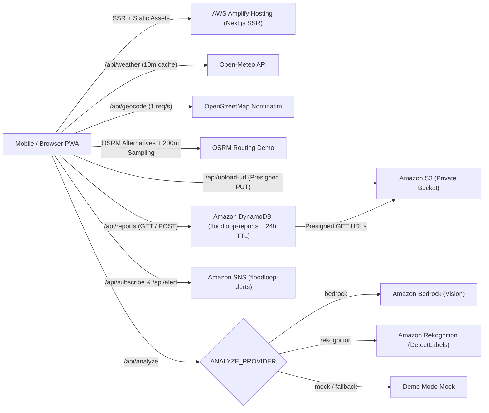

# FloodLoop AI — Maharashtra Flood Watch (AWS Campus to Cloud)

A mobile-first, PWA-ready web application for **Maharashtra waterlogging awareness, crowdsourced flood reporting, and safe route prediction**, built with Next.js (App Router), TypeScript, Tailwind CSS, and **AWS Free Tier** services.

> **Estimated Data Notice**: All 18 hotspot coordinates, elevation values, and `baseVulnerability` scores in [data/hotspots.json](data/hotspots.json) are **estimated** for hackathon demonstration purposes and must be verified against MCGM/BMC, IMD, and state irrigation data before production use.

---

## Architecture



---

## AWS Services Used

| AWS Service | Why It Is Used |
|---|---|
| **AWS Amplify Hosting** | Hosts the Next.js App Router SSR + API routes with GitHub CI/CD and an attached IAM Compute Role (zero hardcoded keys). |
| **Amazon DynamoDB** | Stores shared crowdsourced flood reports (`floodloop-reports`, PK `id`) with automatic 24-hour expiration via DynamoDB TTL (`expiresAt`). |
| **Amazon S3** | Private bucket storing uploaded street flood photos via short-lived presigned PUT URLs and serving thumbnails via presigned GET URLs. |
| **Amazon Bedrock** | Vision-capable foundation model (`BEDROCK_MODEL_ID`) returning structured JSON `{waterPresent, severity, reason}` for street photos. |
| **Amazon Rekognition** | Alternative computer-vision provider (`DetectLabels`) mapping `Flood`, `Water`, `Puddle`, `Car`, and `Person` confidence scores to flood severity. |
| **Amazon SNS** | Email alert subscriptions (`/api/subscribe`) and High/Severe hotspot notifications (`/api/alert`) via `floodloop-alerts`. |

---

## Environment Variables

Copy `.env.example` to `.env.local` for local development, or configure in **Amplify Hosting → Environment variables**:

| Variable | Required | Description |
|---|---|---|
| `ANALYZE_PROVIDER` | No | `"bedrock"` \| `"rekognition"` \| `"mock"` (defaults to `"mock"`). |
| `BEDROCK_MODEL_ID` | When `bedrock` | Vision model ID (e.g. `amazon.nova-lite-v1:0`). |
| `AWS_REGION` | When using AWS | AWS region (e.g. `ap-south-1`). |
| `DDB_TABLE` | No | DynamoDB table name (`floodloop-reports`). Falls back to in-memory/`localStorage` locally. |
| `S3_BUCKET` | No | Private S3 bucket name for report photos. Falls back to compressed local thumbnails if unset. |
| `SNS_TOPIC_ARN` | No | SNS topic ARN (`floodloop-alerts`) for email alerts. |

---

## Local Development

```bash
npm install
cp .env.example .env.local
npm run dev
```

Open [http://localhost:3000](http://localhost:3000). For full AWS deployment steps, see [DEPLOY.md](DEPLOY.md).

---

## Honest Limitations

- **Estimated Hotspot Data**: The 18 hotspots in `data/hotspots.json` (across Mumbai, Thane, Pune, Kolhapur, Sangli, and Chiplun) use estimated coordinates, elevations, and vulnerability weights rather than live municipal sensor feeds.
- **Demo-Mode Mock Fallbacks**: When AWS credentials or env vars (`DDB_TABLE`, `S3_BUCKET`, `SNS_TOPIC_ARN`, `ANALYZE_PROVIDER=mock`) are not configured—or if an AWS call fails—the app gracefully falls back to in-memory/`localStorage` and mock AI responses marked with a visible **Demo mode** badge.
- **Public OSRM & Nominatim Servers**: Safe-route calculation and Maharashtra geocoding rely on public demo servers (`router.project-osrm.org` and `nominatim.openstreetmap.org`), which are rate-limited and lack live traffic/road-closure telemetry.
